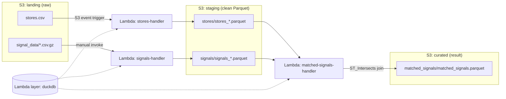

# duckdb-lambda-s3

A small data lake pipeline on AWS Lambda + S3, using DuckDB (with its `spatial` extension) to find
which device signals fall inside which stores. Everything runs locally against
[Floci](https://github.com) (an AWS emulator) and is deployed with Terraform.

## Architecture



| Step | Lambda | Reads | Does | Writes |
|---|---|---|---|---|
| 1 | `stores-handler` | `landing/stores.csv` | converts the WKT column to a geometry | `staging/stores/*.parquet` |
| 2 | `signals-handler` | `landing/signal_data/*.csv.gz` | adds a `date` column and a point geometry | `staging/signals/*.parquet` |
| 3 | `matched-signals-handler` | both staging folders | joins signals to stores with `ST_Intersects` | `curated/matched_signals/matched_signals.parquet` |

Step 3 needs the outputs of steps 1 and 2, so run them in order.

## Project layout

```
src/duckdb_lambda_s3/
  resources/            DuckDBResource (connection config), S3Resource (list / download / upload)
  stores/               stores handler
  signals/              signals handler
  matched_signals/      matched signals handler
infra/                  Terraform (buckets, layer, lambdas, IAM, S3 trigger)
tests/                  unit tests (S3 is faked, DuckDB is real)
data/                   local sample data (not committed)
Makefile                layer build, terraform and pipeline shortcuts
```

The code lives in the Lambda zip. DuckDB lives in a **layer** built from the `lambda` dependency
group in `pyproject.toml`. `boto3` is not in the layer because the Lambda runtime provides it.

## Run it

Requirements: [uv](https://docs.astral.sh/uv/), Terraform, the AWS CLI, and Floci running on
`localhost:4566`.

```bash
uv run pytest                 # unit tests (first run needs internet to fetch the spatial extension)

make layer                    # build the duckdb layer
make tf-init
make tf-apply                 # buckets, layer, three lambdas

make run-pipeline             # upload data, then run stores -> signals -> matched
```

Or step by step: `make upload-data`, `make run-stores`, `make run-signals`, `make run-matched`.
Check the result in `s3://duckdb-demo-curated/matched_signals/`. `make list-functions` shows what
was deployed.

The Makefile sets dummy credentials for Floci. Change the endpoint or project name with
`FLOCI_ENDPOINT=...` and `PROJECT=...`.

> The Lambda runtime must match the layer. `PYTHON_VERSION` in the Makefile and
> `lambda_runtime` in `infra/variables.tf` have to be the same version.

## Demo: running out of memory, and the fix

The signals Lambda writes a large Parquet file. The writer buffers `ROW_GROUP_SIZE` rows per thread
before flushing, so a huge row group on a small Lambda runs out of memory. Both runs use the same
1 GB Lambda and only differ in the row group size:

```bash
make demo-signals-oom    # ROW_GROUP_SIZE 20000000  -> "Out of Memory Error"
make demo-signals-fix    # ROW_GROUP_SIZE 100000    -> succeeds
```

Run `terraform -chdir=infra apply` with no `-var` afterwards to go back to the default sizes. The
memory, DuckDB limit and row group size can be overridden, for example
`make demo-signals-oom DEMO_OOM_ROW_GROUP=50000000`.
